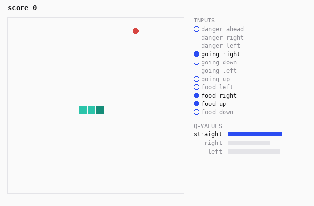
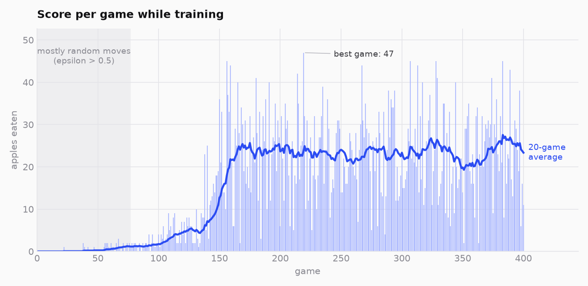
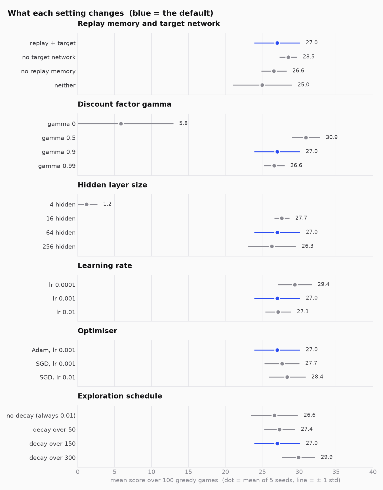

# Neural network that plays Snake

A two-layer neural network, written in plain NumPy, that teaches itself to play Snake with Deep Q-Learning. No PyTorch, no TensorFlow: the forward pass, the loss, backpropagation and the Adam optimiser are all written by hand and checked against numerical gradients.

**Read the build journal:** https://jeyavardhan-l.github.io/Neural-netowrk-plays-snake/
15 chapters from the first line of code to the interview questions, with interactive figures, an annotated source reader, and the trained network playing live in your browser.

<p align="center"></p>

## What it does

| | |
|---|---|
| **Inputs** | 11 numbers, each 0 or 1: danger ahead / right / left, heading (one-hot), food left / right / up / down |
| **Network** | 11 → 64 (ReLU) → 3, 963 parameters, NumPy only |
| **Outputs** | a Q-value for each relative move: straight, turn right, turn left |
| **Rewards** | +10 for food, −10 for a crash, 0 otherwise |
| **Learning** | DQN: epsilon-greedy, replay memory (100k), target network (sync every 500 updates), Adam |
| **Training** | 400 games, about 12 seconds on a laptop CPU |
| **Result** | mean **26.43** apples over 100 greedy games (median 25.5, best 63) |



## What I found

- **The network rediscovered the obvious rule.** A hand-written policy that uses the same 11 inputs (never step into danger, prefer the move towards the food) scores 27.45 on the same boards. The network scores 26.43 and agrees with it on 93.6% of the moves it plays. Random moves score 0.16.
- **The ceiling is the inputs, not the learner.** The 11 inputs can only form 256 combinations. Across 18 variants and 95 training runs (5 seeds each), everything from SGD to Adam, 16 to 256 hidden units, with or without replay and target network, lands between 25 and 31. Every evaluation game ends with the snake trapped in a pocket of its own body that it cannot see.
- **Two settings really matter:** a discount factor above 0 (with γ = 0, four of five seeds learn to circle until they time out) and at least 16 hidden units (4 units score 1.2).
- **Replay memory and the target network barely change the final score here**, but without replay the agent learns about 40 games later.



## Project layout

```
snake_ai/
  game.py          Snake without graphics: rules, rewards, the 11 inputs
  network.py       the network: forward, backward, MSE loss, Adam, SGD
  agent.py         DQN: config, epsilon schedule, replay memory, target network
  training.py      training loop and greedy evaluation
  baselines.py     random and hand-written policies
train.py           train a model
evaluate.py        measure a model
play.py            watch it play in the terminal, or save a GIF
experiments.py     the ablation study (parallel, multi-seed)
analyze.py         baselines and the full 256-input table
make_charts.py     the charts in this README
tests/             42 tests, including a numerical gradient check
models/            the trained model (snake_q.npz, 10 KB)
results/           the main run's log, the experiments and the analysis
docs/              the guide, served by GitHub Pages
tools/guide/       builds the guide from chapter fragments and code annotations
```

## Test guide

Everything below runs on a normal laptop CPU. You need Python 3.10 or newer and git.

### 1. Install

```bash
git clone https://github.com/JeyaVardhan-L/Neural-netowrk-plays-snake.git
cd Neural-netowrk-plays-snake
python3 -m venv .venv
source .venv/bin/activate          # Windows: .venv\Scripts\activate
pip install -r requirements.txt
```

On Ubuntu, if `python3 -m venv` says `ensurepip is not available`, either run `sudo apt install python3-venv python3-pip`, or create the environment without pip and bootstrap it:

```bash
python3 -m venv --without-pip .venv
curl -sSL https://bootstrap.pypa.io/get-pip.py -o get-pip.py
.venv/bin/python get-pip.py
```

### 2. Run the tests (about 2 seconds)

```bash
python -m pytest -q
```

Expected: `42 passed`. What they cover:

| file | checks |
|---|---|
| `tests/test_game.py` | every rule with hand-placed snakes: moving, eating, wall and body crashes, the legal move into the tail's cell, the 11 inputs for several headings, time-out is not terminal, seeding |
| `tests/test_network.py` | shapes and the 963-parameter count, the loss, a **gradient check of every weight against finite differences**, Adam's bias correction, saving and loading |
| `tests/test_agent.py` | epsilon schedule, ring buffer, Bellman target, terminal targets, target-network syncing, and a 60-game run that must beat an untrained network |
| `tests/test_baselines.py` | the hand-written rule, and that the game never produces an input outside the 256 |
| `tests/test_guide.py` | the guide's weights are exactly the trained model, and `docs/` is rebuilt from the current code |

### 3. Watch the trained model

```bash
python play.py                       # the included model, in the terminal (Ctrl+C to stop)
python play.py --random              # an untrained network, for comparison
python play.py --gif my_game.gif     # save a GIF instead
```

### 4. Measure it

```bash
python evaluate.py
```

Expected on the included model:

```
score:   mean 26.43  median 25.5  std 9.87  min 11  max 63
ended:   {'body': 100}
```

```bash
python evaluate.py --random          # baseline: mean 0.0 to 0.2
python analyze.py                    # random 0.16, rule 27.45, network 26.43; 93.6% agreement
```

### 5. Train your own (about 12 seconds)

```bash
python train.py --out runs/mine
python evaluate.py --model runs/mine/model.npz
```

Expected: the printed 25-game average stays near 0 for about 100 games, climbs steeply between games 130 and 170, and settles around 22 to 26. The final greedy evaluation should be between about 20 and 32. On the same machine the run is deterministic; on a different one, tiny floating-point differences can change the path, so expect the same range rather than the same digits.

Every setting is a flag, for example:

```bash
python train.py --gamma 0 --out runs/gamma0          # watch it fail to plan ahead
python train.py --hidden 4 --out runs/tiny           # too small to learn the policy
python train.py --target-sync 0 --out runs/notarget  # no target network
python train.py --help                               # all of them
```

### 6. Re-run the ablation study (about 5 minutes on 12 threads)

```bash
python experiments.py                 # everything: 18 variants x 5 seeds
python experiments.py --only gamma    # one group
python make_charts.py                 # redraw the README charts
```

### 7. Read the guide locally

```bash
python3 -m http.server -d docs 8000
```

Then open http://localhost:8000. If you change code or chapters, rebuild with `python tools/guide/build.py` (and `python tools/guide/export_data.py` after retraining).

### Troubleshooting

| problem | fix |
|---|---|
| `ModuleNotFoundError: numpy` | the virtual environment is not active: `source .venv/bin/activate` |
| `ensurepip is not available` | see step 1 |
| the score stays at 0 after 200 games | check you did not pass `--eps-decay-games` larger than `--games`; with your own changes, check the y direction of "up" and the `(1 - terminal)` in the target |
| `play.py` looks garbled | your terminal needs ANSI colours and Unicode; use `--gif` instead |

## Hosting the guide

GitHub Pages serves the `docs/` folder as it is, with no build step: **Settings → Pages → Deploy from a branch → `main` / `docs`**.

## Licence

MIT. Build your own, and if you improve the inputs (the guide's last chapter has a list), I would like to see it.
